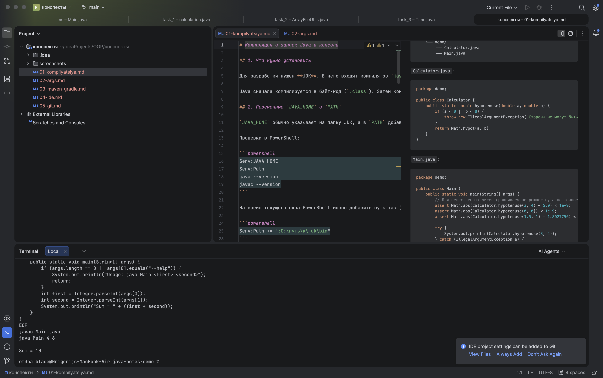

# Компиляция и запуск Java в консоли

## 1. Что нужно установить

Для разработки нужен **JDK**. В него входят компилятор `javac`, команда запуска `java` и стандартные библиотеки. Версию JDK для проекта лучше сверить с преподавателем и настройкой проекта.

Java сначала компилируется в байт-код (`.class`). Затем команда `java` запускает JVM, которая исполняет этот байт-код. В обычном случае JVM нужна и для запуска уже скомпилированной программы. В C обычно получают машинный исполняемый файл под конкретную платформу; Java-программа запускается на платформе, где есть подходящая JVM.

## 2. Переменные `JAVA_HOME` и `PATH`

`JAVA_HOME` обычно указывает на папку JDK, а в `PATH` добавляют её папку `bin`, чтобы команды `java` и `javac` находились из любой папки.

Проверка в PowerShell:

```powershell
$env:JAVA_HOME
$env:Path
java --version
javac --version
```

На время текущего окна PowerShell можно добавить путь так (замените пример на свою папку JDK):

```powershell
$env:Path += ";C:\путь\к\jdk\bin"
```

В macOS/Linux для текущего окна терминала:

```bash
export JAVA_HOME="/путь/к/jdk"
export PATH="$JAVA_HOME/bin:$PATH"
java --version
javac --version
```

Чтобы настройка сохранялась после перезапуска, добавьте её в настройки переменных среды Windows или в файл настройки оболочки macOS/Linux. После изменения откройте новое окно терминала.

## 3. Команды для папок и файлов

Переходите в папку проекта перед компиляцией.

| Действие | PowerShell | macOS/Linux (bash/zsh) |
|---|---|---|
| Текущая папка | `Get-Location` | `pwd` |
| Список файлов | `Get-ChildItem` | `ls -la` |
| Перейти в папку | `Set-Location путь` | `cd путь` |
| На уровень выше | `Set-Location ..` | `cd ..` |
| Удалить файл | `Remove-Item файл.txt` | `rm файл.txt` |

`Tab` дополняет имя файла или папки. Стрелки `↑` и `↓` помогают выбрать предыдущие команды. Удаление необратимо удаляет выбранный файл, поэтому сначала проверьте текущую папку.

## 4. Исходный файл, пакет и компиляция

Имя файла с `public`-классом должно совпадать с именем класса: `Main.java` содержит `public class Main`. Если в начале файла написано `package demo;`, файл должен лежать в папке `demo`.

Пример структуры:

```text
project/
└── src/
    └── demo/
        ├── Calculator.java
        └── Main.java
```

`Calculator.java`:

```java
package demo;

public class Calculator {
    public static double hypotenuse(double a, double b) {
        if (a < 0 || b < 0) {
            throw new IllegalArgumentException("Стороны не могут быть отрицательными");
        }
        return Math.hypot(a, b);
    }
}
```

`Main.java`:

```java
package demo;

public class Main {
    public static void main(String[] args) {
        // Для вещественных чисел сравниваем погрешность, а не точное равенство.
        assert Math.abs(Calculator.hypotenuse(3, 4) - 5.0) < 1e-9;
        assert Math.abs(Calculator.hypotenuse(0, 0)) < 1e-9;
        assert Math.abs(Calculator.hypotenuse(1.5, 1) - 1.8027756) < 1e-6;

        try {
            System.out.println(Calculator.hypotenuse(3, 4));
        } catch (IllegalArgumentException e) {
            System.out.println("Ошибка: " + e.getMessage());
        }
    }
}
```

Из корневой папки проекта:

```bash
javac --release 17 -d out src/demo/Calculator.java src/demo/Main.java
java -ea -cp out demo.Main
```

- `javac` компилирует `.java` в `.class`.
- `-d out` кладёт результат в папку `out`, сохраняя структуру пакета.
- `--release 17` задаёт версию Java для компиляции; укажите версию проекта.
- `-cp out` задаёт путь, где JVM ищет классы.
- `demo.Main` — полное имя класса с пакетом.
- `-ea` включает проверки `assert`. Без этого флага Java по умолчанию не выполняет `assert`.

Если пакет не задан и все файлы лежат в одной папке, для простого примера достаточно `javac Main.java`, затем `java Main`.



На снимке видно, что после `javac Main.java` команда `java Main 4 6` запускает программу и печатает результат.

## 5. Исключения и типичные ошибки

Метод может сообщить о неправильных данных через `throw`, например `IllegalArgumentException`. В месте вызова такую ситуацию можно обработать через `try/catch`, как в примере `Main`. Так ошибка объясняется пользователю, а программа может продолжить работу или аккуратно завершиться.

## 6. Проверки и типичные ошибки

Вычислительный метод удобно проверять на нескольких примерах: обычном, граничном (`0`) и с дробными числами. Для `double` задают допустимую погрешность, например `1e-6`.

- `javac: command not found` или «не является командой» — проверьте JDK и `PATH`.
- `cannot find symbol` — проверьте имя, пакет, импорты и наличие всех нужных `.java` файлов.
- `Could not find or load main class` — проверьте текущую папку, `-cp` и полное имя класса с пакетом.
- `AssertionError` — одна из проверок `assert` не прошла; проверьте ожидаемое значение и вычисление.

## Источники

- [Задание: компиляция, тесты и args](https://github.com/VetrovSV/OOP/blob/master/plans/tasks_java.md)
- [Команда `javac`](https://docs.oracle.com/en/java/javase/26/docs/specs/man/javac.html)
- [Команда `java` и флаг `-ea`](https://docs.oracle.com/en/java/javase/26/docs/specs/man/java.html)
