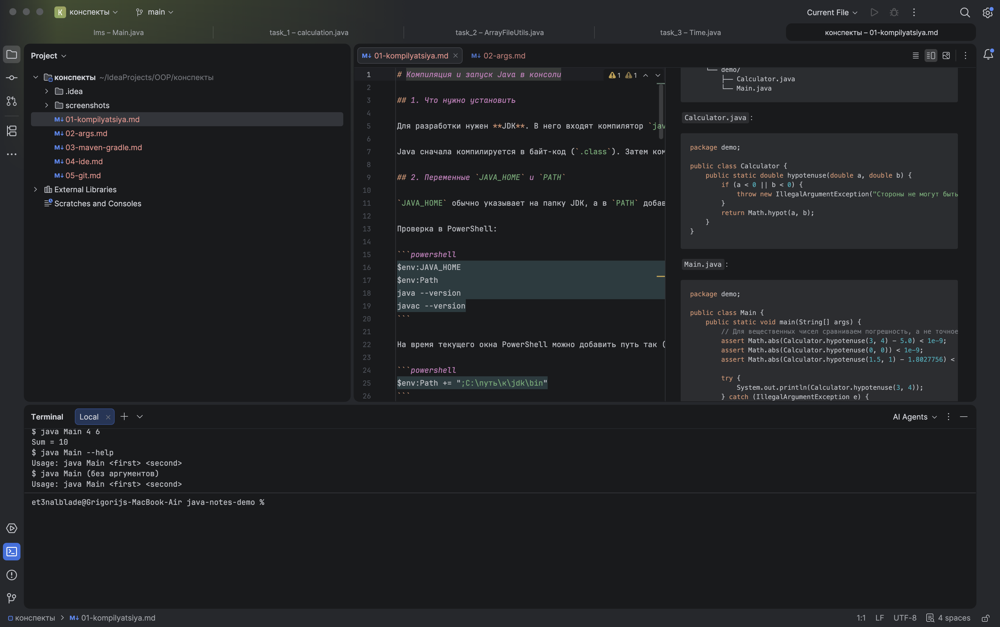

# Аргументы командной строки в Java (`args`)

## 1. Что такое `args`

Главный метод программы объявляется так:

```java
public static void main(String[] args)
```

`args` — массив строк, которые пользователь передал после имени главного класса. Например, в команде:

```bash
java -cp out demo.ArgsDemo 4 6
```

элементы массива будут `args[0] == "4"` и `args[1] == "6"`. Параметры сначала являются строками, поэтому числа нужно преобразовать через `Integer.parseInt` или `Double.parseDouble`.

Параметры JVM идут **до** имени класса, параметры программы — **после**:

```bash
java -Xmx512m -cp out demo.ArgsDemo 4 6
```

Здесь `-Xmx512m` — параметр виртуальной машины, а `4 6` попадут в `args`.

## 2. Пример: `--help`, аргументы или ввод через `Scanner`

Требование задания: показать подсказку для `help`/`--help`; если аргументов нет — спросить значения через `Scanner`; если переданы нужные аргументы — использовать их без повторного запроса.

```java
package demo;

import java.util.InputMismatchException;
import java.util.Scanner;

public class ArgsDemo {
    private static int sum(int a, int b) {
        return a + b;
    }

    public static void main(String[] args) {
        if (args.length > 0 && (args[0].equals("help") || args[0].equals("--help"))) {
            printHelp();
            return;
        }

        int a;
        int b;
        try {
            if (args.length == 0) {
                Scanner scanner = new Scanner(System.in);
                System.out.print("Введите два целых числа: ");
                a = scanner.nextInt();
                b = scanner.nextInt();
            } else if (args.length == 2) {
                a = Integer.parseInt(args[0]);
                b = Integer.parseInt(args[1]);
            } else {
                printHelp();
                return;
            }

            System.out.println("Сумма: " + sum(a, b));
        } catch (NumberFormatException | InputMismatchException e) {
            System.out.println("Ошибка: нужно ввести два целых числа.");
        }
    }

    private static void printHelp() {
        System.out.println("Пример: java demo.ArgsDemo 4 6");
        System.out.println("Без аргументов программа запросит числа в консоли.");
    }
}
```

Запуск после компиляции:

```bash
java -cp out demo.ArgsDemo 4 6
java -cp out demo.ArgsDemo --help
java -cp out demo.ArgsDemo
```

Если аргумент содержит пробел, передавайте его в кавычках, например `"hello world"`: оболочка передаст его одним элементом массива.



В примере показаны запуск с `4 6`, справка по `--help` и запуск без аргументов.

## 3. Что проверить

1. Вызвать программу без аргументов — должны появиться запросы для `Scanner`.
2. Передать нужное количество аргументов — программа должна сразу обработать их.
3. Передать `help` и `--help` — должна появиться подсказка.
4. Передать неправильное количество аргументов или текст вместо числа — должна появиться понятная ошибка.

В IntelliJ IDEA значения для `args` вводятся в поле **Program arguments** настройки запуска. Например: `4 6`. Параметры JVM (`-ea`, `-Xmx512m`) вводятся отдельно в **VM options**.

## Источники

- [Задание по Java: интерфейс командной строки и args](https://github.com/VetrovSV/OOP/blob/master/plans/tasks_java.md)
- [Настройки аргументов и VM options в IntelliJ IDEA](https://www.jetbrains.com/help/idea/program-arguments-and-environment-variables.html)
