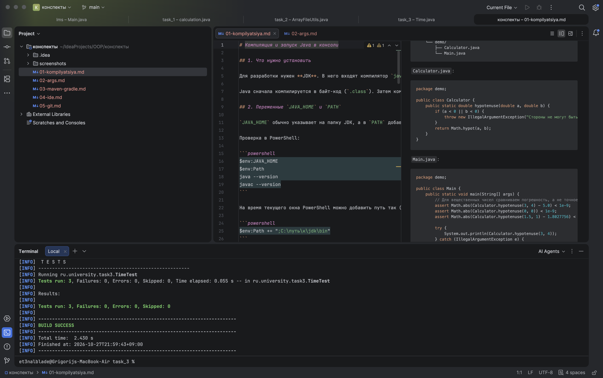

# Системы сборки: Maven и Gradle

## 1. Зачем нужна система сборки

`javac` компилирует указанные исходные файлы. Maven и Gradle автоматизируют повторяющиеся шаги проекта: компиляцию, тесты, подключение библиотек и упаковку результата. Настройки проекта хранятся в файле сборки, поэтому сборку можно повторить из IDE или консоли.

- **Maven** описывает проект в `pom.xml`, настройки записываются в XML.
- **Gradle** описывает проект в `build.gradle` (Groovy) или `build.gradle.kts` (Kotlin DSL).

В задании можно выбрать одну систему.

## 2. Проверка и создание проекта

Проверить установку:

```bash
mvn --version
```

или:

```bash
gradle --version
```

Для Maven проверьте, что `JAVA_HOME` указывает на папку JDK. В IntelliJ IDEA можно использовать встроенное управление Maven/Gradle, не устанавливая команду отдельно.

Создать шаблон Maven из корневой папки, где будет проект:

```bash
mvn archetype:generate -DgroupId=com.mycompany -DartifactId=myapp -DarchetypeArtifactId=maven-archetype-quickstart -DinteractiveMode=false
```

Переходите в созданную папку `myapp` перед остальными командами.

Для нового проекта Gradle можно запустить `gradle init` и выбрать тип `java-application`. Рекомендуется добавить Gradle Wrapper: `gradlew` для macOS/Linux и `gradlew.bat` для Windows. Wrapper запускает версию Gradle, заданную проектом.

## 3. Структура проекта

Обычная структура Java-проекта:

```text
myapp/
├── pom.xml                 # Maven; у Gradle — build.gradle[.kts]
├── src/
│   ├── main/java/          # исходный код программы
│   ├── main/resources/     # файлы, нужные программе
│   ├── test/java/          # тесты
│   └── test/resources/     # файлы для тестов
└── target/                 # результат Maven; у Gradle обычно build/
```

Файлы из `src/main/java` — программа, файлы из `src/test/java` — автоматические проверки. Папки `target` и `build` создаются сборкой, исходниками они не являются.

## 4. Основные команды Maven

Команды запускаются из папки с `pom.xml`:

```bash
mvn compile       # скомпилировать основную программу
mvn test          # скомпилировать и выполнить тесты
mvn package       # пройти предыдущие фазы и собрать JAR
mvn clean package # удалить старые результаты и собрать заново
```

Если проект без внешних библиотек, можно запустить класс из папки компиляции:

```bash
java -cp target/classes com.mycompany.App
```

При внешних зависимостях нужно также включить библиотеки в classpath; проще запускать через IntelliJ IDEA или настроенный плагин Maven.

Для задания перенесите программу из работы 1 в Maven-проект, добавьте тесты, запустите `mvn test`, затем проверьте, что проект собирается и запускается из консоли.

### Бонус: исполняемый JAR

`mvn package` создаёт JAR. Чтобы команда `java -jar ...` знала главный класс, в манифест JAR нужно добавить `Main-Class`. Это настраивается плагином `maven-jar-plugin`. Если приложение использует сторонние библиотеки, простой JAR обычно не содержит их; потребуется настроить упаковку зависимостей или использовать дистрибутив.



Здесь команда `mvn test` завершилась успешно: все три теста прошли.

## 5. Основные команды Gradle

Выполняйте из папки проекта. В примерах ниже `./gradlew` замените на `gradlew.bat` в Windows:

```bash
./gradlew tasks       # посмотреть доступные задачи
./gradlew build       # собрать проект и выполнить проверки
./gradlew test        # запустить тесты
./gradlew run         # запустить приложение, если включён application plugin
./gradlew clean       # удалить результаты предыдущей сборки
```

Чтобы задача `run` была доступна, в `build.gradle` нужно подключить плагин приложения и указать главный класс:

```groovy
plugins {
    id 'application'
}

application {
    mainClass = 'com.mycompany.App'
}
```

Для передачи параметров программе можно использовать:

```bash
./gradlew run --args="4 6"
```

## 6. Что написать в отчёте

- Что делает система сборки и чем она помогает.
- Чем Maven/Gradle отличаются от ручной команды `javac`.
- Что лежит в `pom.xml` или `build.gradle`.
- Где находятся код, тесты и результаты сборки.
- Какие команды использованы для компиляции, запуска и тестирования.
- Подтверждение, что перенесённая программа собирается и запускается из консоли.

## Источники

- [Задание по Maven/Gradle](https://github.com/VetrovSV/OOP/blob/master/plans/tasks_java.md)
- [Стандартная структура Maven-проекта](https://maven.apache.org/guides/introduction/introduction-to-the-standard-directory-layout)
- [Жизненный цикл сборки Maven](https://maven.apache.org/guides/introduction/introduction-to-the-lifecycle)
- [Команды Gradle](https://docs.gradle.org/current/userguide/command_line_interface.html)
- [Gradle Application Plugin и запуск `run`](https://docs.gradle.org/current/userguide/application_plugin.html)
