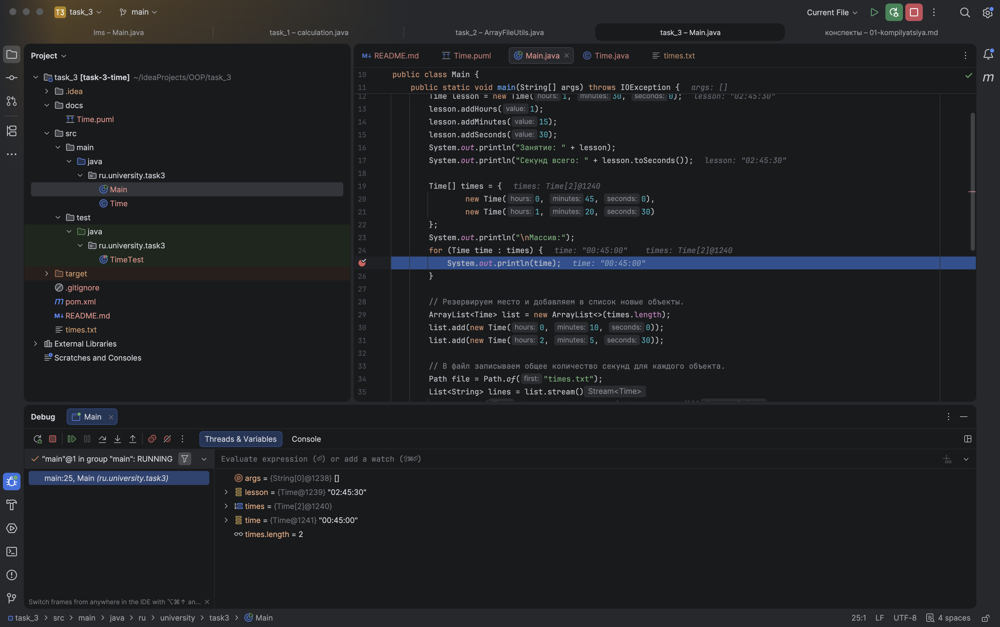
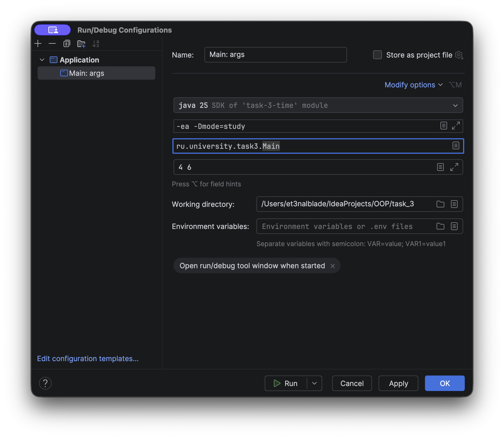
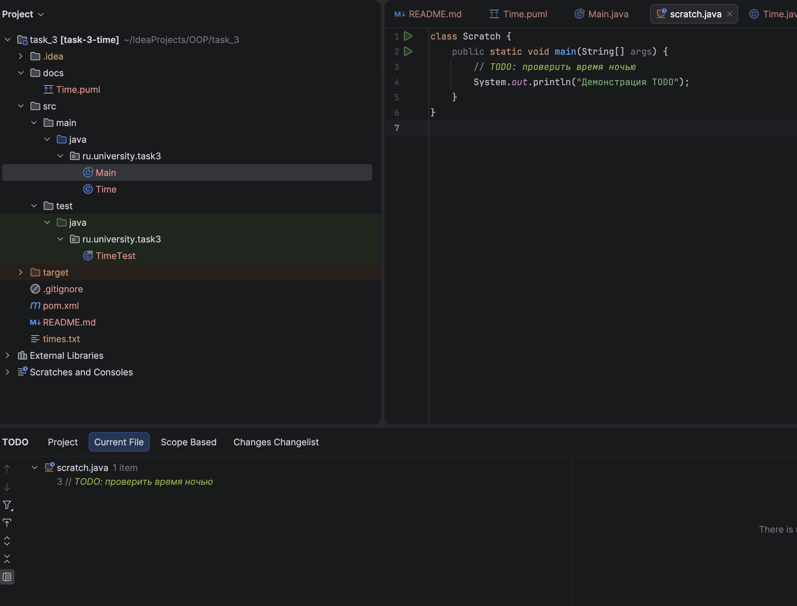
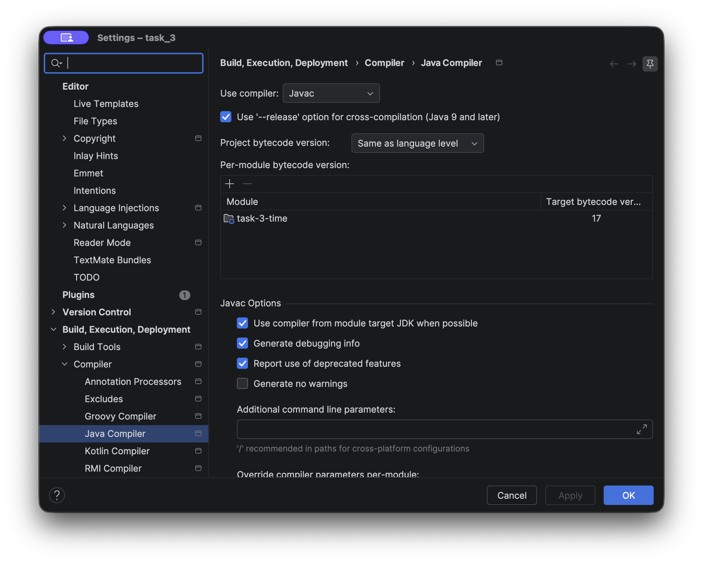

# Конспект по IntelliJ IDEA

## 1. Открытие проекта и структура

Откройте папку проекта через **File → Open**. Для Maven выберите `pom.xml`, для Gradle — `build.gradle` или `build.gradle.kts`, если IDE предлагает импортировать проект.

Проверьте JDK: **File → Project Structure → Project SDK**. Версия JDK должна быть совместима с настройкой проекта. Если проект Maven/Gradle, версия языка также задаётся в `pom.xml` или файле Gradle; IDE должна импортировать эту настройку.

Обычно в проекте:

- `src/main/java` — классы программы;
- `src/test/java` — тесты;
- `pom.xml` или `build.gradle` — зависимости и правила сборки;
- `target/` или `build/` — файлы, полученные при сборке;
- `.idea/` — настройки IDE; личные настройки рабочего места обычно не коммитят.

## 2. Сборка, запуск и отладка

- **Build Project** компилирует проект и показывает ошибки в окне Build.
- **Run** запускает выбранную конфигурацию и показывает вывод в Run.
- **Debug** запускает программу с отладчиком.
- Для Maven/Gradle полная задача `build` может запускать тесты и упаковку; кнопка Build Project в IDE может выполнять только компиляцию. Проверяйте окно Maven/Gradle для запуска нужной задачи.

Горячие клавиши ниже приведены для стандартной раскладки Windows/Linux. На macOS и в другой раскладке они отличаются; актуальную комбинацию можно найти через **Find Action** (`Ctrl+Shift+A`) или настройки **Keymap**.

| Действие | Клавиша Windows/Linux |
|---|---|
| Найти действие | `Ctrl+Shift+A` |
| Найти файл/класс/действие | дважды `Shift` |
| Собрать проект | `Ctrl+F9` |
| Запустить | `Shift+F10` |
| Запустить в отладке | `Shift+F9` |
| Пересобрать | `Ctrl+Shift+F9` |
| Исправление/контекстные действия | `Alt+Enter` |
| Переформатировать код | `Ctrl+Alt+L` |

## 3. Отладка на примере массива

```java
Time[] times = {
    new Time(0, 45, 0),
    new Time(1, 20, 30)
};
for (Time time : times) {
    System.out.println(time);
}
```

1. Поставьте точку останова на строке `System.out.println(time)` — щёлкните рядом с номером строки.
2. Запустите `main` через **Debug**. Программа остановится на точке останова.
3. В окне Debug можно посмотреть текущую переменную `time` и массив `times`. Кнопка **Step Over** выполняет строку и переходит дальше.
4. **Resume** продолжает программу до следующей точки останова или конца.
5. В **Frames/Call Stack** виден текущий метод. В этом простом примере это `main`.

Отладчик помогает посмотреть значения переменных, не добавляя временные `println` в каждую строку.



В окне видны текущий элемент `time`, массив `times` и кадр `main` в списке вызовов.

## 4. Параметры запуска программы и JVM

Откройте **Run → Edit Configurations** и выберите конфигурацию типа **Application**.

- **Main class** — класс с методом `main`.
- **Program arguments** — аргументы программы, например `4 6` или `--help`; они попадут в `String[] args`.
- **VM options** — параметры JVM, например `-ea -Xmx512m -Dmode=study`.
- **Working directory** — папка, относительно которой программа читает/записывает файлы.
- **Environment variables** — переменные окружения процесса.

`-ea` включает Java `assert`. `-Xmx512m` задаёт максимальный объём памяти JVM. `-Dmode=study` создаёт системное свойство, читаемое через `System.getProperty("mode")`.



В `Program arguments` указаны `4 6`, а в `VM options` — `-ea -Dmode=study`.

## 5. Версия Java и параметры компилятора

Сначала проверьте, что **Project SDK**, язык проекта и целевая версия байт-кода совместимы. Путь к настройке компилятора: **Settings → Build, Execution, Deployment → Compiler → Java Compiler**.

В окне компилятора можно выбрать версию bytecode и задать **Additional command line parameters**. Например, `--release 17` ограничивает используемые API и формат классов версией Java 17. Для ручной компиляции это же задаётся командой `javac --release 17 ...`.

Для Maven/Gradle обычно указывают версию в файле сборки, чтобы команда сборки и IDE использовали одно значение. Не задавайте разные версии в `pom.xml`/Gradle и настройках IDE.

## 6. Рефакторинг

Рефакторинг — изменение структуры кода с сохранением поведения программы. Он нужен, чтобы безопасно переименовать класс или метод, вынести часть кода, переместить класс либо изменить сигнатуру.

Часто используемые действия:

- **Rename** (`Shift+F6`) — переименовать класс, метод или переменную вместе с использованием имени в проекте;
- **Extract Method** (`Ctrl+Alt+M`) — вынести выделенные строки в отдельный метод;
- **Introduce Variable** (`Ctrl+Alt+V`) — дать выражению имя;
- **Refactor This** (`Ctrl+Alt+Shift+T`) — открыть список доступных действий.

Комбинации могут зависеть от версии и раскладки; при необходимости найдите действие через `Ctrl+Shift+A`.

## 7. TODO-комментарии

Комментарий `// TODO: проверить граничный случай` отмечает задачу, которую нужно выполнить позже. IDE ищет такие комментарии и показывает их в окне **View → Tool Windows → TODO**. Вкладка Project показывает задачи по проекту, Current File — только по открытому файлу. Нажатие на задачу переводит к строке с комментарием.

TODO — напоминание разработчику, а не описание готового поведения. Перед сдачей проверьте список и удалите выполненные пункты или оставьте только действительно запланированные.





Первый снимок показывает комментарий в scratch-файле и пункт в окне TODO. Второй показывает компилятор Javac и версию байт-кода модуля 17.

## 8. Файлы для Git

Обычно отслеживают исходники, тесты, `README.md`, UML, `pom.xml`/`build.gradle`, `.gitignore` и необходимые файлы Gradle Wrapper. Обычно не отслеживают `*.class`, `target/`, `build/`, кэш IDE и личные настройки рабочего места. Если нужно поделиться конфигурацией запуска, её можно сохранить как общий файл конфигурации проекта.

## 9. Git в IntelliJ IDEA

Если проект уже является Git-репозиторием, IDEA обычно показывает изменения в окне Git. Если репозиторий ещё не создан, выберите **VCS → Enable Version Control Integration → Git**. Через окно Git можно просматривать изменения, выбрать файлы для коммита, записать сообщение и выполнить commit. Для отправки изменений используется **Push**. Перед коммитом проверьте список файлов и diff, чтобы случайно не включить сгенерированные файлы или чужие изменения. Для сдачи удобно уметь показать статус, diff, историю и переключение веток как в терминале, так и через IDE.

## Что показать преподавателю

- Запустить программу обычным способом и в режиме Debug.
- Поставить точку останова в цикле и показать значения переменных и стек вызовов.
- Показать поля Program arguments и VM options на примере `--help` и `-ea`.
- Показать настройку целевой версии Java и дополнительные параметры компилятора.
- Добавить `// TODO: ...` и найти этот пункт в окне TODO.
- Переименовать метод или вынести цикл в отдельный метод через рефакторинг IDEA.

## Источники

- [Задание по среде разработки](https://github.com/VetrovSV/OOP/blob/master/plans/tasks_java.md)
- [Run/Debug-конфигурация Java](https://www.jetbrains.com/help/idea/run-debug-configuration-java-application.html)
- [Параметры запуска и JVM](https://www.jetbrains.com/help/idea/program-arguments-and-environment-variables.html)
- [Сборка проекта в IntelliJ IDEA](https://www.jetbrains.com/help/idea/build-overview.html)
- [Настройки компилятора Java](https://www.jetbrains.com/help/idea/java-compiler.html)
- [Отладка кода](https://www.jetbrains.com/help/idea/debugging-code.html)
- [Горячие клавиши Windows/Linux](https://www.jetbrains.com/help/idea/reference-keymap-win-default.html)
- [Рефакторинг](https://www.jetbrains.com/help/idea/refactoring-source-code.html)
- [TODO-окно](https://www.jetbrains.com/help/idea/todo-tool-window.html)
