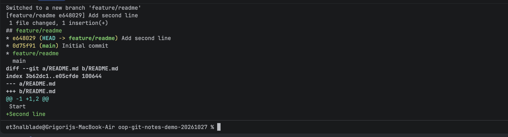
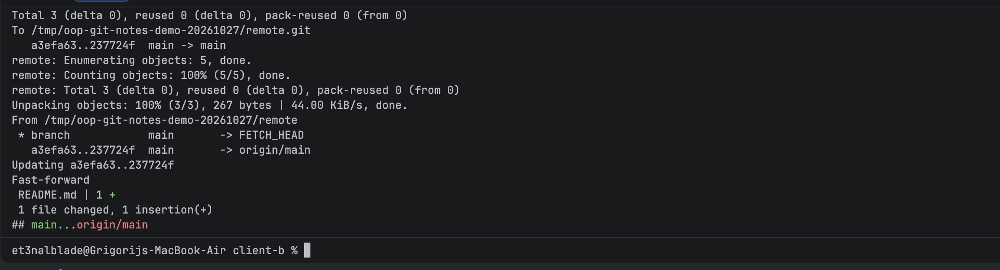
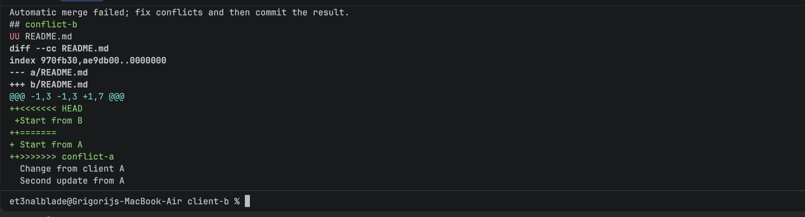
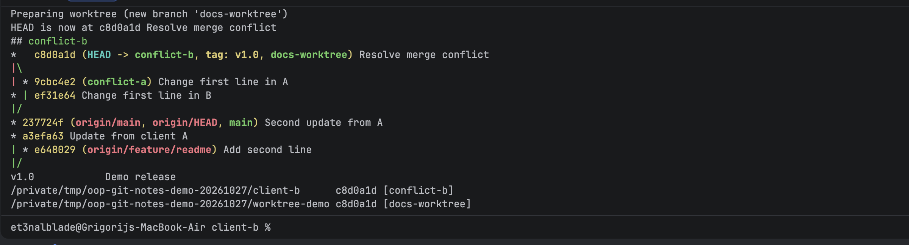

# Git и консоль

## 1. Шпаргалка по консоли

| Действие | PowerShell | macOS/Linux (bash/zsh) |
|---|---|---|
| Показать текущую папку | `Get-Location` | `pwd` |
| Перейти в папку | `Set-Location путь` | `cd путь` |
| Перейти на уровень выше | `Set-Location ..` | `cd ..` |
| Показать файлы, включая скрытые | `Get-ChildItem -Force` | `ls -la` |
| Удалить файл | `Remove-Item имя` | `rm имя` |

`Tab` дополняет путь и имя файла. Стрелка `↑` возвращает предыдущую команду; в PowerShell список также можно посмотреть через `Get-History`, в bash/zsh поиск по истории обычно открывается `Ctrl+R`. Перед удалением проверьте текущую папку.

## 2. Что такое Git

Git — система контроля версий. Она хранит историю изменений и помогает сравнивать версии программы, возвращаться к прошлому состоянию и работать над разными задачами в отдельных ветках.

- **Репозиторий** — папка проекта вместе с историей Git. Локальный репозиторий находится на компьютере; удалённый — например, на GitHub.
- **Рабочая папка** — текущие файлы проекта.
- **Индекс (staging area)** — выбранные изменения, которые войдут в следующий коммит.
- **Коммит** — зафиксированный снимок проекта с сообщением.
- **Ветка** — имя, которое указывает на отдельную линию коммитов.
- **Конфликт** — Git не может сам объединить изменения, например две ветки изменили одну и ту же строку.

К Git обычно добавляют исходники, тесты, документацию, UML, `pom.xml`, `build.gradle`, `.gitignore` и Gradle Wrapper. Не добавляют пароли и токены, скомпилированные `.class`, папки `target/` и `build/`, кэш IDE и личные настройки. Файл `.gitignore` перечисляет то, что Git должен игнорировать.

## 3. Учебная последовательность команд

Чтобы потренировать команды с самого начала, используйте отдельную учебную копию проекта. Не запускайте `git init` внутри папки, которая уже находится под другим Git-репозиторием.

### Создать репозиторий и первый коммит

```bash
git init -b master
git status
```

Если Git ещё не знает имя автора, задайте их только для этого репозитория:

```bash
git config user.name "Ваше Имя"
git config user.email "you@example.com"
```

Добавьте файлы к следующему коммиту и проверьте состояние:

```bash
git add .
git status
git diff --cached
git commit -m "Добавлен учебный проект"
```

`git add` помещает изменения в индекс, `git status` показывает состояние, `git diff --cached` показывает то, что попадёт в коммит.

### Исправить сообщение и сравнить коммиты

Сразу после создания последнего локального коммита можно исправить его сообщение:

```bash
git commit --amend -m "Создан учебный проект"
```

`amend` создаёт новый коммит вместо последнего и меняет его идентификатор. Не переписывайте уже отправленный общий коммит без согласования.

Измените файл проекта, затем посмотрите разницу, сохраните изменения и создайте ещё один коммит:

```bash
git status
git diff
git add README.md
git diff --cached
git commit -m "Обновлена документация"
git diff HEAD~1 HEAD
git log --oneline
```

Замените `README.md` на файл, который вы реально изменили. `git diff` показывает ещё не добавленные изменения; `git diff HEAD~1 HEAD` сравнивает два последних коммита.

### Создать ветку, изменить файлы и объединить

```bash
git branch feature/example
git switch feature/example
```

Измените файл в этой ветке и сравните её с `master`:

```bash
git diff master...feature/example
git add README.md
git commit -m "Добавлен пример"
git show master:README.md
git switch master
git merge feature/example
git log --oneline --graph --all
```

`git show master:README.md` показывает версию файла, записанную в коммитах ветки `master`. Если основная ветка называется `main`, замените `master` на `main`.



## 4. Удалённый репозиторий: clone, push и pull

Чтобы отправить существующий локальный проект в пустой удалённый репозиторий, сначала добавьте его адрес:

```bash
git remote add origin <URL-удалённого-репозитория>
git remote -v
git push -u origin master
```

`push` отправляет ваши коммиты. `-u` связывает локальную ветку с удалённой, поэтому дальше часто достаточно `git push`.

Чтобы получить отдельную копию удалённого проекта:

```bash
git clone <URL-удалённого-репозитория>
cd имя-склонированной-папки
git pull --ff-only
```

`clone` скачивает проект и историю, `pull` получает новые коммиты и обновляет текущую ветку. Если вы меняли файлы локально, сначала проверьте `git status` и сохраните изменения. В `git pull` добавление из удалённой ветки может привести к конфликту.

Для демонстрации обмена изменениями удобно открыть два клона: сделать коммит и `push` в одном, затем выполнить `pull` во втором. На снимке для примера использован локальный bare-репозиторий и две копии проекта, поэтому вход в GitHub не нужен.



## 5. Дополнительные пункты задания

### Worktree

Worktree позволяет работать с другой веткой в отдельной папке, используя ту же историю репозитория. Ветка не должна уже быть открыта в другой рабочей папке.

```bash
# Перейдите в другую ветку, чтобы master не был занят текущей папкой.
git switch feature/example
git worktree add ../OOP-master master
git worktree list
```

Папка `../OOP-master` должна быть свободна. После проверки дополнительную папку можно убрать:

```bash
git worktree remove ../OOP-master
```

### Смоделировать и исправить конфликт

1. На ветке `master` создайте `conflict-a`, измените одну строку файла и сделайте коммит.
2. Вернитесь на `master`, создайте `conflict-b`, измените **ту же строку иначе** и тоже сделайте коммит.
3. На `conflict-b` выполните `git merge conflict-a`. Git покажет конфликт.
4. Откройте файл. Удалите маркеры `<<<<<<<`, `=======`, `>>>>>>>` и оставьте правильный итоговый текст.
5. Проверьте файл, затем выполните:

```bash
git status
git add имя-файла
git commit -m "Разрешён конфликт"
```

Конфликт — это не потеря истории. Git просит разработчика выбрать итоговый вариант; после редактирования файл нужно добавить в индекс и завершить слияние.

### Тег

Тегом отмечают важный коммит, например версию программы:

```bash
git tag -a v1.0 -m "Первая версия"
git tag
git show v1.0
```

Если репозиторий связан с удалённым, тег можно отправить командой `git push origin v1.0`.



После ручного редактирования конфликт был завершён отдельным коммитом. На следующем снимке видны история, тег `v1.0` и обе рабочие папки worktree.



## 6. Короткие ответы на вопросы задания

- **Зачем нужна система контроля версий?** Чтобы хранить историю, сравнивать изменения, возвращаться к прошлым версиям и работать в ветках.
- **Чем отличаются локальный и удалённый репозитории?** Локальный находится на компьютере; удалённый хранится на сервере и помогает обмениваться коммитами.
- **Что добавлять в Git?** Исходный код, тесты, документацию и необходимые файлы сборки. Не добавлять секреты и генерируемые файлы.
- **Когда создавать ветку?** Когда работаешь над отдельной функцией, исправлением или экспериментом, который не должен сразу менять основную ветку.
- **Как исправить конфликт?** Открыть отмеченный файл, выбрать итоговое содержимое, убрать маркеры, выполнить `git add`, затем завершить слияние коммитом.

## Важно для папки OOP

Папка `/Users/et3nalblade/IdeaProjects/OOP` уже является Git-репозиторием. Не создавайте второй репозиторий внутри `task_3` или `конспекты`. В этой папке сейчас есть незакоммиченные файлы, поэтому перед практикой проверьте `git status` и добавляйте только нужные пути, а не делайте вслепую `git add .`. Для тренировки первого коммита и `amend` безопаснее использовать отдельную учебную копию.

## Источники

- [Задание «Работа с Git»](https://github.com/VetrovSV/OOP/blob/master/%D0%97%D0%B0%D0%B4%D0%B0%D0%BD%D0%B8%D1%8F-I.md)
- [Git: init](https://git-scm.com/docs/git-init), [add](https://git-scm.com/docs/git-add), [commit](https://git-scm.com/docs/git-commit), [branch](https://git-scm.com/docs/git-branch), [switch](https://git-scm.com/docs/git-switch)
- [Git: diff](https://git-scm.com/docs/git-diff), [merge](https://git-scm.com/docs/git-merge), [clone](https://git-scm.com/docs/git-clone), [pull](https://git-scm.com/docs/git-pull), [push](https://git-scm.com/docs/git-push)
- [Git: worktree](https://git-scm.com/docs/git-worktree), [tag](https://git-scm.com/docs/git-tag)
